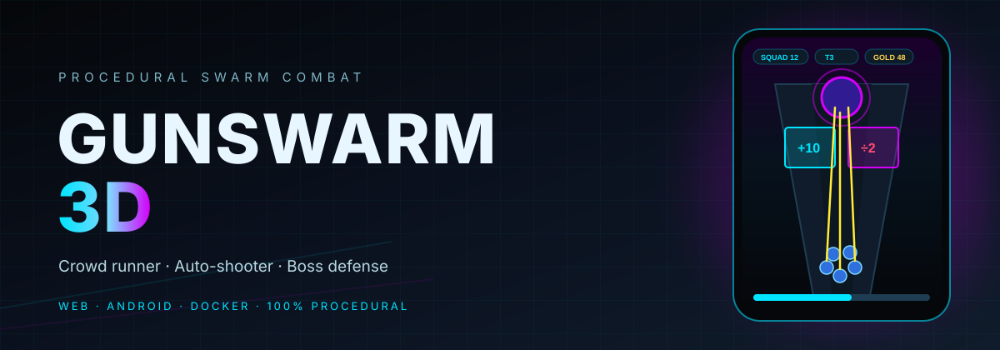
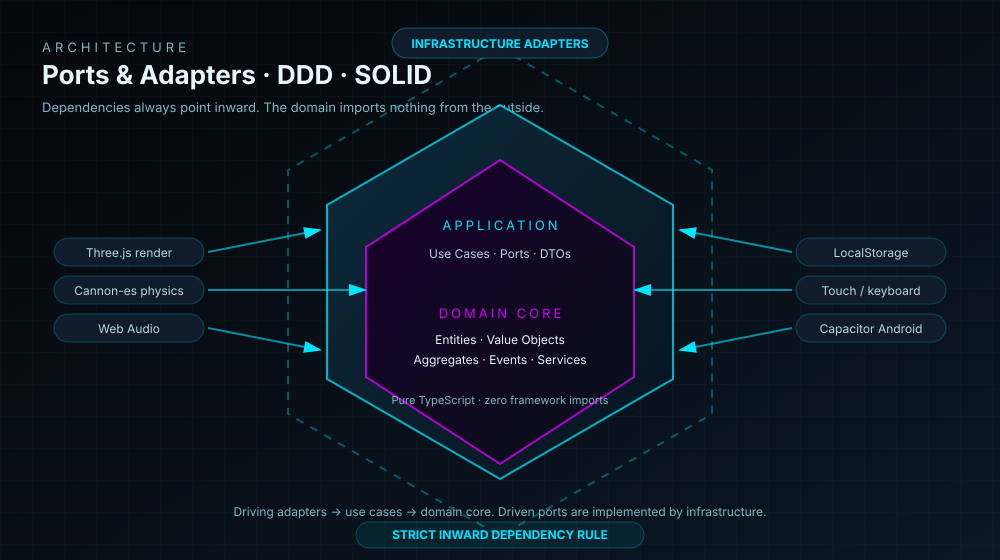
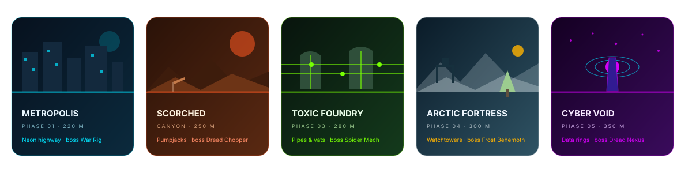
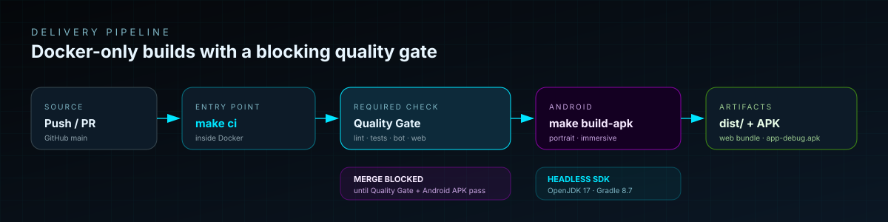

<p align="center">
  
</p>

<p align="center">
  
</p>

# GunSwarm 3D

A production-grade 3D hyper-casual **crowd runner, auto-shooter and boss defense** game. It runs in a responsive 9:16 web viewport and ships as an Android APK through a fully Dockerized pipeline.

The codebase follows **Domain-Driven Design**, **Hexagonal Architecture (Ports & Adapters)** and **SOLID**, with a hard Anti-God-File rule: every source file stays below 150 lines.

## At a glance

| Area | Implementation |
| :--- | :--- |
| **Gameplay** | Single leader, recruit-able swarm, continuous auto-fire, math gates, hazards, pickups and five bosses |
| **Rendering** | Three.js · 27 procedural entity variants · zero external 3D models |
| **Physics** | Cannon-es behind an isolated `PhysicsPort` adapter |
| **Audio** | Web Audio API · 10 synthesized effects · zero audio files |
| **Persistence** | LocalStorage meta-progression, currency and permanent upgrades |
| **Platforms** | Responsive web + Capacitor Android APK (portrait, immersive) |
| **Quality** | TypeScript strict, ESLint, Vitest, Docker-only builds and CI gates |

## Architecture

<p align="center">
  
</p>

The **domain core is pure TypeScript** and imports nothing from Three.js, Cannon-es, Capacitor or the DOM. Use cases depend on ports; infrastructure adapters implement them and are wired at the composition root in `src/main.ts`.

Detailed contracts and boundaries: [ARCHITECTURE.md](ARCHITECTURE.md).

## Gameplay and controls

- One controllable **Squad Leader**; recruited troopers follow in a Fermat-spiral formation.
- **Automatic fire** at the weapon's cadence — no manual shoot button.
- Choose a lane at every math gate. Each gate clearly shows its effect: `+10`, `x2`, `-5`, `÷2`.
- Collect coins, weapon chests and shield orbs; destroy obstacles and defeat the phase boss.
- Reach the boss arena, survive its approach and burn it down.

| Action | Touch | Desktop |
| :--- | :--- | :--- |
| Move laterally | Drag on the game canvas | `A` / `D` or `←` / `→` |
| Start / retry | On-screen buttons | On-screen buttons |
| Meta upgrades | Defeat screen → **Upgrades** | Defeat screen → **Upgrades** |

## Five procedural biomes

<p align="center">
  
</p>

Each phase changes fog, lighting, side scenery, track length and boss: **War Rig**, **Dread Chopper**, **Spider Mech**, **Frost Behemoth** and **Dread Nexus**.

## Quick start

Requirements: Docker Engine 24+, Docker Compose 2.20+ and GNU Make 4.3+.

```bash
make init      # build images and install dependencies
make dev       # Vite HMR at http://localhost:5173
```

Quality gate:

```bash
make lint
make test
make ci        # init-ci + lint + test + build-web
```

Production preview:

```bash
make build-web
make preview    # http://localhost:4173
```

## Android APK

Capacitor is configured in `capacitor.config.ts`. The committed `android/` project enforces **portrait orientation** and **immersive fullscreen** mode.

```bash
make build-apk
```

Output:

```text
output/app-debug.apk
```

## CI and merge protection

<p align="center">
  
</p>

`.github/workflows/ci.yml` publishes two required checks:

- **Quality Gate** — lint, 295 tests and production web build.
- **Android APK** — headless Gradle build uploaded as an artifact.

Configure `main` branch protection as described in [.github/BRANCH_PROTECTION.md](.github/BRANCH_PROTECTION.md). While either check fails, GitHub blocks the merge.

## Documentation

| Document | Contents |
| :--- | :--- |
| [GDD.md](GDD.md) | Full game design, math, biomes, entities, combat and progression |
| [ARCHITECTURE.md](ARCHITECTURE.md) | DDD, Hexagonal boundaries, ports and directory contracts |
| [AGENT_RULES.md](AGENT_RULES.md) | Autonomous engineering rules and anti-god-file policy |
| [PROGRESS.md](PROGRESS.md) | Atomic implementation tracker (all phases complete) |
| [.github/BRANCH_PROTECTION.md](.github/BRANCH_PROTECTION.md) | Required checks and merge-blocking setup |

---

**Stack:** TypeScript · Three.js · Cannon-es · Web Audio · Capacitor · Vite · Vitest · Docker · GitHub Actions
